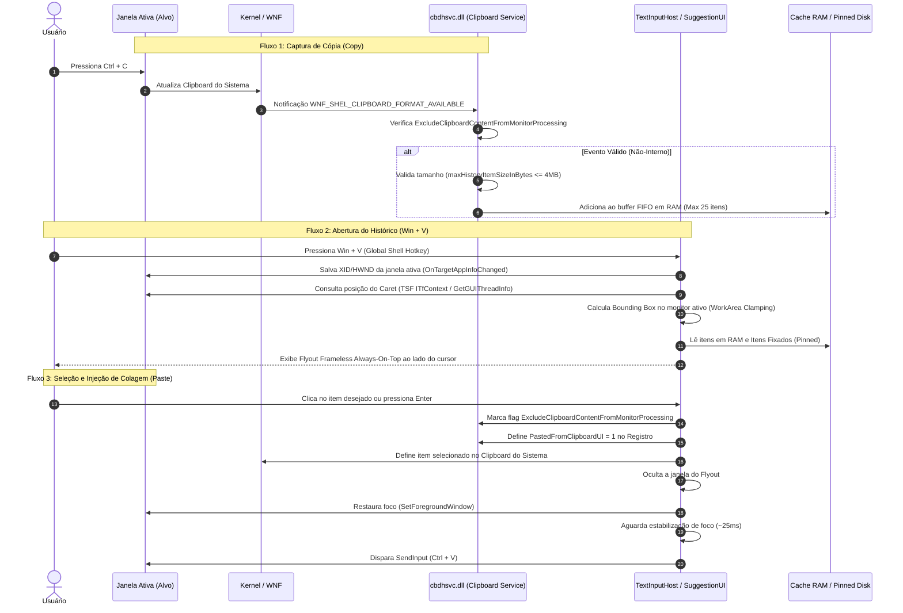
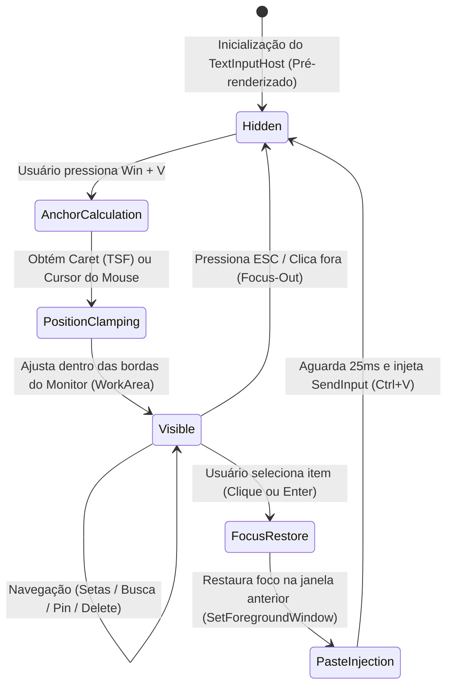

# Especificação Técnica de Engenharia Reversa: Subsistema de Histórico da Área de Transferência do Windows (`Win + V`)

Este documento consolida a análise detalhada de engenharia reversa conduzida nos binários nativos do Windows 10/11 responsáveis pela funcionalidade de Histórico da Área de Transferência global (`Win + V`), incluindo os serviços de background, formato de dados, ciclo de vida, gerenciamento de janelas e injeção de entrada.

---

## 1. Mapeamento dos Binários e Componentes

| Componente | Binário / Caminho | Função Primária |
| :--- | :--- | :--- |
| **Serviço de Background** | `C:\Windows\System32\cbdhsvc.dll` | *Clipboard User Service* (`cbdhsvc_<LUID>`). Monitora a área de transferência, filtra formatos, gerencia o buffer em memória e persistência de itens fixados. |
| **Host de Interface** | `C:\Windows\SystemApps\MicrosoftWindows.Client.CBS_cw5n1h2txyewy\TextInputHost.exe` | Processo host UWP/WinRT isolado responsável por hospedar componentes modernos de digitação e sugestão. |
| **Orquestrador de Flyout** | `...Client.CBS_cw5n1h2txyewy\WindowsInternal.ComposableShell.Experiences.SuggestionUIUndocked.dll` | Gerencia o flyout flutuante do `Win + V` (`FloatingSuggestionUIClipboardHistory`) e painel de emojis (`Win + .`), cálculo de âncora e injeção de colagem. |
| **Biblioteca de Entrada** | `...Client.CBS_cw5n1h2txyewy\TextInput.dll` | Integração com o *Text Services Framework* (TSF), coordenadas de Caret, monitoramento de seleção e foco. |
| **Recursos de UI** | `...Client.CBS_cw5n1h2txyewy\resources.pri` | Recursos de acessibilidade, templates e strings do `CLIPBOARDVIEWER`. |

---

## 2. Diagrama de Arquitetura de Alto Nível (Mermaid)



---

## 3. Especificação do Serviço de Clipboard (`cbdhsvc.dll`)

### 3.1 Interceptação e Filtragem de Cópia
O serviço opera em nível de sessão do usuário e monitora as alterações da área de transferência através do subsistema WNF (*Windows Notification Facility*):
* `RtlSubscribeWnfStateChangeNotification` escuta as mudanças de estado.
* Na ocorrência de uma alteração, `ClipboardMonitor_LocalClipboardContentsChanged` é acionado.
* **Inspeção de Origem:** Obtém o processo em primeiro plano via `GetForegroundWindow` e `GetWindowThreadProcessId` para rastrear contexto de segurança corporativa (EDP - *Enterprise Data Protection*, `isEdpItem`).
* **Prevenção de Duplicação e Loops de Auto-Colagem:**
  * O Windows registra o formato customizado: `ExcludeClipboardContentFromMonitorProcessing`.
  * Quando o próprio subsistema do `Win + V` atualiza o clipboard para injetar uma colagem, esse formato é registrado. O `ClipboardMonitor` detecta a flag e descarta o processamento (`ClipboardMonitor_RemovedDuplicateFromBuffer`).

### 3.2 Tabela de Constantes e Limites do Sistema

| Constante Interna | Valor Descoberto | Descrição |
| :--- | :--- | :--- |
| `maxBufferItemsCount` | **25 itens** | Capacidade máxima do buffer circular FIFO de itens não fixados. |
| `maxHistoryItemSizeInBytes` | **4.194.304 bytes** (4 MB) | Tamanho máximo permitido para um único item. Itens maiores disparam `UnpinnedItemSizeExceeded` e são descartados. |
| `maxHistorySizeInBytes` | Dinâmico (~32 MB) | Limite total de memória alocada para o buffer volátil em RAM. |
| `TimeoutWhenWaitingForClipboardChange` | 500 ms | Timeout máximo para liberação de mutex de leitura do clipboard. |
| `FocusStabilizationDelay` | ~25 ms | Intervalo entre a restauração da janela alvo e a injeção do evento `SendInput`. |

### 3.3 Formatos Suportados
Identificados nas classes `DataPackageSerializer` e `Deserializer_ProcessFormat`:
1. **Texto:** `CF_UNICODETEXT` (`Text`), `CF_TEXT` (`AnsiText`), `PlainText`.
2. **HTML:** `HTML Format` (formato estruturado com cabeçalhos `StartHTML`, `EndHTML`, `StartFragment`, `EndFragment`).
3. **RTF:** `Rich Text Format`.
4. **Imagens:** `CF_DIB` (`DeviceIndependentBitmap`), `CF_DIBV5`, `PNG`, `Bitmap`.
5. **URIs / Links:** `UniformResourceLocator`, `ApplicationLink`, `StorageItem`.

---

## 4. Ciclo de Vida e Estrutura de Armazenamento

### 4.1 Separação Híbrida: RAM vs. Disco

```
+-----------------------------------------------------------------------+
|                            MEMÓRIA RAM                                |
|  - Buffer Circular FIFO (máx 25 itens não-fixados)                   |
|  - Limpo no encerramento da sessão / reboot / logoff                  |
|  - Itens Fixados mantidos também em memória para acesso imediato      |
+-----------------------------------------------------------------------+
                                   |
                     (Ao clicar no botão "Pin / Fixar")
                                   v
+-----------------------------------------------------------------------+
|                           DISCO LOCAL                                 |
|  Caminho: %LOCALAPPDATA%\Microsoft\Windows\Clipboard\Pinned\{GUID}\   |
|  - metadata.json (Catálogo de metadados em JSON)                      |
|  - Payload individual por GUID (comprimido ou bruto)                 |
+-----------------------------------------------------------------------+
```

### 4.2 Estrutura do Arquivo `metadata.json`
Localizado em `%LOCALAPPDATA%\Microsoft\Windows\Clipboard\Pinned\{SessionGUID}\metadata.json`:

```json
{
  "items": {
    "{9B6677D2-C4AD-4259-8F77-F8845F9F7CF6}": {
      "timestamp": "2026-10-12T20:22:00.000Z",
      "source": "Local",
      "cloud_id": null,
      "EnterpriseId": null,
      "formats": ["Text", "HTML Format"]
    }
  }
}
```

* **Restauração de Sessão:** Ao iniciar o serviço, `ClipboardHistoryDataStore_TryRestorePersistedSession` localiza a pasta mais recente com `metadata.json` válido e chama `ClipboardHistoryBuffer_RestorePinnedItems`, recarregando os itens fixados na RAM antes de aceitar conexões da UI.

---

## 5. Máquina de Estados da Interface e Posicionamento



### 5.1 Algoritmo de Cálculo de Posição
1. **Âncora Primária (Caret):** Consulta `ITfContext::GetTextExt` (TSF). Se indisponível, consulta `GetGUIThreadInfo` (`rcCaret`) e converte para coordenadas globais com `ClientToScreen`.
2. **Âncora Fallback (Ponteiro do Mouse):** Se nenhum campo de texto tiver o caret ativo, utiliza `GetCursorPos`.
3. **Bounding Box do Monitor:**
   * Identifica o monitor ativo via `MonitorFromPoint(cursor)`.
   * Obtém as coordenadas da área de trabalho (`rcWork` via `GetMonitorInfo`).
   * **Eixo Vertical:** Tenta posicionar abaixo da âncora (`y = anchor.y + 10`). Se `y + popup.height > rcWork.bottom`, inverte para cima da âncora (`y = anchor.y - popup.height - 10`).
   * **Eixo Horizontal:** Alinha com `anchor.x`. Se `x + popup.width > rcWork.right`, ajusta para `x = rcWork.right - popup.width - 10`.

### 5.2 Fluxo de Injeção de Colagem Automática
1. Armazena o identificador da janela em foco no momento do acionamento (`hwndTarget`).
2. Atualiza a área de transferência com o item escolhido e ativa as flags `ExcludeClipboardContentFromMonitorProcessing` e `PastedFromClipboardUI`.
3. Oculta o popup.
4. Restaura a janela de destino chamando `SetForegroundWindow(hwndTarget)`.
5. Executa uma pausa de estabilização de **25 ms** para que o loop de mensagens da janela alvo processe o foco.
6. Dispara o atalho de colagem (`Ctrl + V`) via `SendInput`.
